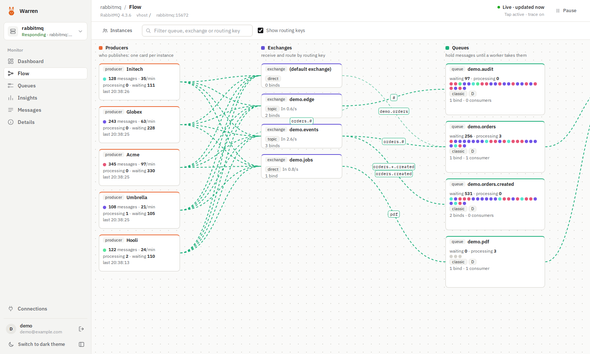
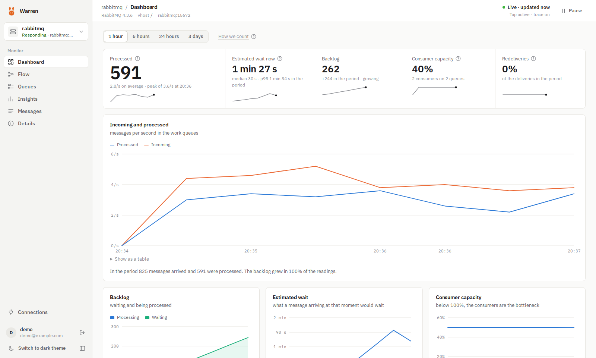
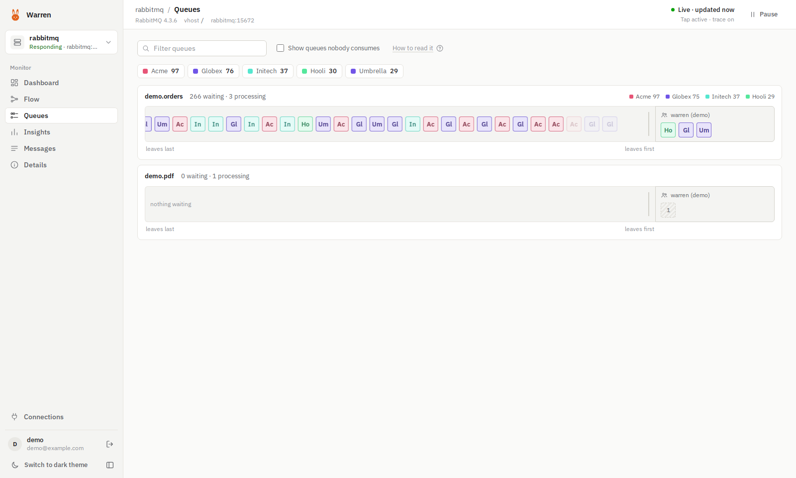

<p align="center"></p>

<h1 align="center">Warren</h1>

<p align="center">
  A visual, open-source dashboard for RabbitMQ: see who sends what, where it waits and who is processing it.
  <br><br>
  <strong>English</strong> · <a href="README.pt-BR.md">Português</a>
</p>

<p align="center"></p>

## Why

The RabbitMQ management UI answers "how many messages are in this queue?". When several clients, tenants or services share
one broker, the questions people actually ask are different:

- **Who** is filling the queues right now, and is one tenant delaying everybody else?
- **Where** is a message stuck, and which worker is supposed to take it?
- **How long** does a message wait before it is processed, and is the backlog draining or growing?
- **What failed**, written in words a non-engineer can read?

Warren answers those by drawing the broker as a live diagram, following each message from the producer to the worker, and
turning the management API's numbers into an operational analysis.

## Features

- **Flow**: producers → exchanges → queues → workers, with every binding and full routing key. Each queue shows what is waiting
  and what is being processed, one dot per message coloured by the tenant that sent it.
- **Queues**: every queue drawn as an actual line of packages, from arrival to the worker, so you can see who is ahead of whom
  (including the effect of message priorities). Click a package to open the message.
- **Dashboard**: messages processed in the period, estimated wait (Little's law), time to drain the backlog, consumer
  capacity, redelivery rate, and a table of work queues ordered by how slow they are. Queues without consumers by design
  (results, retries, dead letters) are left out of the totals.
- **Insights**: alerts (no consumer, stalled queue, failures piling up, unroutable messages), a ranking of who sends the most,
  business areas and queues under pressure.
- **Messages**: what the tap captured, where each message is now, and its properties, headers and body, with passwords,
  tokens and JWTs masked.
- **Tenants as producers**: one card per tenant/client/service found in the messages (body path, header or routing key regex).
- **Catalog**: business names and areas instead of technical queue names, plus "panels" that turn result and error queues
  into plain-language event lists.
- **Several brokers**: add, test and switch connections from the UI; passwords are encrypted at rest and never sent back.
- **Read-only towards your broker**: it only reads the management API, and the tap uses its own temporary, exclusive queues.
- Light and dark themes, Portuguese and English, login with rate limiting, everything served from one Docker image.

| Dashboard | Queues |
|---|---|
|  |  |

## Try it in two minutes

The demo stack adds a throwaway RabbitMQ (with the message trace on) and a traffic generator that publishes for five fake
tenants, so every part of the screen has something to show:

```bash
git clone https://github.com/JasomRocha/warren-rmq.git && cd warren-rmq
printf 'WARREN_ADMIN_EMAIL=demo@example.com\nWARREN_ADMIN_PASSWORD=demo-password\n' > .env
docker compose -f docker-compose.yml -f docker-compose.demo.yml up --build
```

Open http://localhost:8080 and sign in with the e-mail and password above. Never point the demo file at a real broker.

## Use it with your RabbitMQ

```bash
cp .env.example .env
docker compose up -d --build
docker compose exec app php artisan warren:user you@example.com   # first user (asks for the password)
```

Open http://localhost:8080, sign in and add your broker under **Connections**. "Test connection" checks the management API
and the AMQP port before saving. Two containers start from the same image: `app` (the UI) and `tap` (one process that listens
to every connection and samples the dashboard metrics every 30 seconds).

- The broker user needs the management plugin; the `monitoring` tag is lighter on the broker than `management`.
  For the tap, it also needs configure, write and read permissions on the vhost.
- Producers and messages need the tap. Turn on the broker trace (`rabbitmqctl trace_on`) to also see messages published straight
  to a queue and real delivery times.
- The port is bound to `127.0.0.1`. Before exposing Warren to a network, serve it over HTTPS and read [SECURITY.md](SECURITY.md).

The full documentation (catalog, panels, tenant detection, every setting) is in Portuguese:
[README.pt-BR.md](README.pt-BR.md). Translations are welcome.

## Development

```bash
composer install && npm install
php artisan test     # PHP (PHPUnit)
npm test             # front end (Vitest)
npm run typecheck    # vue-tsc
scripts/smoke.sh     # against a running instance; CI runs it on the demo stack
```

Laravel 12, Inertia and Vue 3 with TypeScript, SQLite, php-amqplib. The charts are plain SVG, with no chart library.
Design decisions live in [docs/DESIGN.md](docs/DESIGN.md).

## Contributing

Issues and pull requests are welcome. See [CONTRIBUTING.md](CONTRIBUTING.md).

## License

[MIT](LICENSE)
